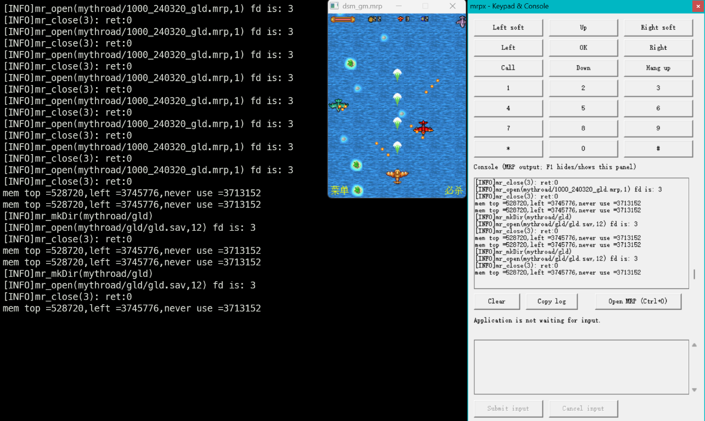

# mrpx

mrpx 是基于 VMRP 项目重构整理的 Mythroad MRP 模拟器。README 按主题拆分为三个入口：

## 1. 当前项目介绍

[项目介绍与运行方式](docs/PROJECT.md)：了解 mrpx 的定位、当前平台、主要功能和使用方法。

## 2. 项目背景历史

[项目来源与历史](docs/HISTORY.md)：了解 mrpx 与原 VMRP 项目的关系、维护者说明和历史 Guest 资料现状。

## 3. 研究开发指南

[研究与开发指南](docs/GUIDE.md)：从桌面/Web 复现开始，进入构建、发布、MRP 格式、Guest ABI 和 ARM/Thumb 研究资料。

项目采用 GPL-3.0，详见 [LICENSE](LICENSE)。
